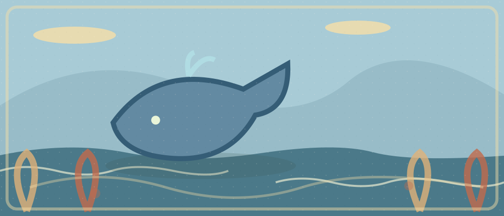

# 2026-10-10 · Whale Songs and Ocean Noise

**One complete article:** [How Do Whales 'Sing?'](https://learningenglish.voanews.com/a/how-do-whales-sing-/7498692.html). Its audio, transcript, reading, selected paragraphs and all output tasks form one learning journey. **No memorizing the whole article.**

**30 minutes:** Listening 6 · Reading 9 · Active Expressions 4 · Speaking 4 · Writing 5 · Retrieval/Reflection 2.

## Multimedia Companion

- **Direct audio:** [VOA publisher MP3](https://voa-audio.voanews.eu/vle/2024/02/23/01000000-0a00-0242-edf7-08dc34886528_hq.mp3?download=1) (complete playback not newly verified).
- **Transcript / full article:** [How Do Whales 'Sing?'](https://learningenglish.voanews.com/a/how-do-whales-sing-/7498692.html).
- **Source page:** [VOA Learning English](https://learningenglish.voanews.com/a/how-do-whales-sing-/7498692.html).
- **HTML companion:** [Illustrated reader](./2026-10-10-English-Whale-Songs-and-Ocean-Noise.html).

## Listening · 6 min

Listen once for overall meaning (2 min). If lost, open this hint *after* attempting: 

中文语境
VOA 报道研究者如何解释鲸类的歌声机制；今天只使用这篇文章，不再把 NOAA 海洋噪声文章当第二篇精读。

Choose **one 20–40-second section** you want to understand or reuse. Note timestamp ___. Match its English transcript to the sounds (2 min), focusing on a single unclear word boundary, referent or contrast. Hide the transcript and listen again (2 min). Do not confuse learning the plot from Chinese with recognizing the English sounds.

**Actual evidence:** first understanding ___; timestamp ___; words recognized without text ___; corrected relation ___.

## Reading · 9 min

**Read this same [complete VOA article](https://learningenglish.voanews.com/a/how-do-whales-sing-/7498692.html), not another reading source.** Spend 4 min labeling paragraph functions; reconstruct the full model:

1. 鲸鱼的歌声引出科学问题
2. 科学家研究声音如何产生
3. 报道描述发声结构或研究方法
4. 结论仍受样本和物种范围限制

**1–3 selected paragraphs (3 min):**

1. **问题/语境：**开篇提出鲸为什么能发声的段落。去原文定位，不虚构引文；判断主语、转折与段落功能。
2. **例子/机制：**描述科学家研究方式和声学机制的段落。去原文定位，不虚构引文；判断主语、转折与段落功能。
3. **结果/限定：**解释研究结果与仍有疑问的段落。去原文定位，不虚构引文；判断主语、转折与段落功能。

Close the page and reconstruct the full article in 3–4 links (2 min). Check one precise misunderstanding. **Scope:** 一个关于发声机制的研究不能被直接扩大到所有鲸类的所有行为。

## Active Expressions · 4 min

**Only one target expression:** First retrieve from the Chinese meaning: “鲸类在交流中依靠声音。”

Reveal after trying
**rely on**. Use it to describe the article or your own experience; do not assume this is a verbatim source quote.

**New context:** 换成学生依靠反馈提高发音，或者团队依靠日志排查故障。 Practise pronunciation with the original clip if the phrase occurs there; otherwise speak your original transfer sentence, using your configured Obsidian TTS if desired.

## Speaking · 4 min

Respond aloud and progressively, without reading a script:

1. What question about whale songs does the reporter ask?
2. How did researchers investigate sound production?
3. Which part is direct evidence and which part is interpretation?
4. What should an aquarium exhibit explain rather than only playing whale recordings?

**One breakdown, one repair:** ___

## Writing · 5 min

**80–120 words, original response:** Should marine-science exhibitions explain how scientists study whale songs instead of only playing recordings? Ground your view in the VOA report.

Minimal structure hint
Position → article detail → personal example → limitation → conclusion.

**Your real draft:**

<!-- Write your own draft here after completing the task; no model essay. -->

## Retrieval/Reflection · 2 min

Full-article model (without looking) ___ · English sounds recognized without transcript ___ · one transfer sentence ___ · one gap to repair ___

**Tomorrow (30–60 sec):** replay the selected audio with no text; retrieve **rely on** from meaning, then use a genuinely different situation. Leave blank until you actually do it: ___.

### 8-minute Busy Version

2 min audio · 2 min whole-article skim and one selected paragraph · 1 min match transcript to 20–40s clip · 1 min listen without text · 1 min transfer speaking · **1 min micro-writing** (claim + reason).

## Connections

- [[EnglishLearning/Connections|Connections map]] · [[EnglishLearning/README|Daily Notes]]. Next-day retrieval matters more than reciting the source from memory.

## Previous / Next

- Previous: [[drafts/EnglishLearning/2026-10-09-English-Food-Heritage-and-Reinvention|2026-10-09 · Food Heritage and Reinvention]]
- Next (next published note; 2026-10-11 is not published): [[EnglishLearning/2026-10-12-English-When-AI-Misses-Not|2026-10-12 · When AI Misses 'Not']]
