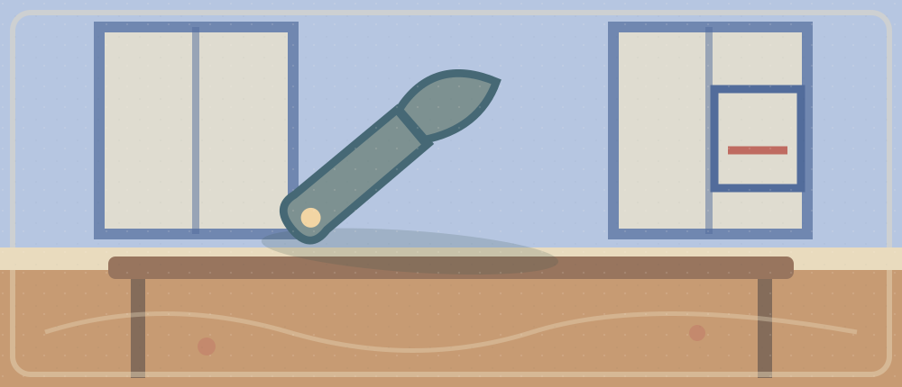

# 2026-10-14 · Repair or Replace

**One complete article:** [Tech Tip: How to Make Your Smartphone Last Longer](https://learningenglish.voanews.com/a/tech-tip-how-to-make-your-smartphone-last-longer/7765975.html). Its audio, transcript, reading, selected paragraphs and all output tasks form one learning journey. **No memorizing the whole article.**

**30 minutes:** Listening 6 · Reading 9 · Active Expressions 4 · Speaking 4 · Writing 5 · Retrieval/Reflection 2.

## Multimedia Companion

- **Direct audio:** [VOA publisher MP3](https://voa-audio.voanews.eu/vle/2024/09/03/0d8ed3cb-5c5c-45b7-ae5b-e3edbdcd8027_hq.mp3?download=1) (complete playback not newly verified).
- **Transcript / full article:** [Tech Tip: How to Make Your Smartphone Last Longer](https://learningenglish.voanews.com/a/tech-tip-how-to-make-your-smartphone-last-longer/7765975.html).
- **Source page:** [VOA Learning English](https://learningenglish.voanews.com/a/tech-tip-how-to-make-your-smartphone-last-longer/7765975.html).
- **HTML companion:** [Illustrated reader](./2026-10-14-English-Repair-or-Replace.html).

## Listening · 6 min

Listen once for overall meaning (2 min). If lost, open this hint *after* attempting: 

中文语境
VOA 介绍延长智能手机使用时间的实用建议；电池每天续航与整台设备的长期寿命不完全是一回事。

Choose **one 20–40-second section** you want to understand or reuse. Note timestamp ___. Match its English transcript to the sounds (2 min), focusing on a single unclear word boundary, referent or contrast. Hide the transcript and listen again (2 min). Do not confuse learning the plot from Chinese with recognizing the English sounds.

**Actual evidence:** first understanding ___; timestamp ___; words recognized without text ___; corrected relation ___.

## Reading · 9 min

**Read this same [complete VOA article](https://learningenglish.voanews.com/a/tech-tip-how-to-make-your-smartphone-last-longer/7765975.html), not another reading source.** Spend 4 min labeling paragraph functions; reconstruct the full model:

1. 用户为何经常考虑换手机
2. 手机使用寿命受若干习惯影响
3. 报道提供延长使用的建议
4. 需要区分日常续航与总使用年限

**1–3 selected paragraphs (3 min):**

1. **问题/语境：**提出为什么要让手机用得更久的段落。去原文定位，不虚构引文；判断主语、转折与段落功能。
2. **例子/机制：**介绍电池维护或设备使用建议的段落。去原文定位，不虚构引文；判断主语、转折与段落功能。
3. **结果/限定：**解释建议的适用情境或注意事项的段落。去原文定位，不虚构引文；判断主语、转折与段落功能。

Close the page and reconstruct the full article in 3–4 links (2 min). Check one precise misunderstanding. **Scope:** 文章提供日常建议，不能保证每个设备都能因此延寿某个精确年数。

## Active Expressions · 4 min

**Only one target expression:** First retrieve from the Chinese meaning: “适当维护可以延长设备的使用寿命。”

Reveal after trying
**extend the lifespan of**. Use it to describe the article or your own experience; do not assume this is a verbatim source quote.

**New context:** 将手机换成学校电脑、耳机或骑行装备。 Practise pronunciation with the original clip if the phrase occurs there; otherwise speak your original transfer sentence, using your configured Obsidian TTS if desired.

## Speaking · 4 min

Respond aloud and progressively, without reading a script:

1. Why do people replace phones that still work?
2. Which maintenance suggestion in the report seems practical?
3. How is battery runtime different from a phone's total lifespan?
4. When might replacing a device still make sense?

**One breakdown, one repair:** ___

## Writing · 5 min

**80–120 words, original response:** Using the VOA phone-maintenance advice, explain whether your university should teach students to maintain devices before replacing them.

Minimal structure hint
Position → article detail → personal example → limitation → conclusion.

**Your real draft:**

<!-- Write your own draft here after completing the task; no model essay. -->

## Retrieval/Reflection · 2 min

Full-article model (without looking) ___ · English sounds recognized without transcript ___ · one transfer sentence ___ · one gap to repair ___

**Tomorrow (30–60 sec):** replay the selected audio with no text; retrieve **extend the lifespan of** from meaning, then use a genuinely different situation. Leave blank until you actually do it: ___.

### 8-minute Busy Version

2 min audio · 2 min whole-article skim and one selected paragraph · 1 min match transcript to 20–40s clip · 1 min listen without text · 1 min transfer speaking · **1 min micro-writing** (claim + reason).

## Connections

- [[EnglishLearning/Connections|Connections map]] · [[EnglishLearning/README|Daily Notes]]. Next-day retrieval matters more than reciting the source from memory.

## Previous / Next

- Previous: [[EnglishLearning/2026-10-13-English-Focus-Under-Pressure|2026-10-13 · Focus Under Pressure]]
- Next: pending the next lesson.
