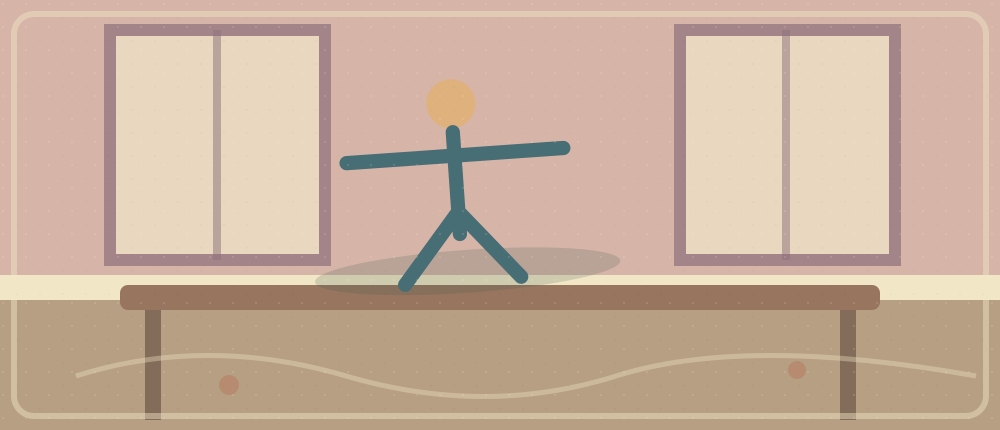

# 2026-10-26 · AI and Accessibility

> Visual companion: thematic storybook illustration. Open the linked HTML for icon navigation and interactive recall.

**Big question:** How can AI help people access learning without replacing the learning itself?

**30-minute plan:** Listening 6 · Reading 9 · Active Expressions 4 · Speaking 4 · Writing 5 · Retrieval/Reflection 2 = **30 min**.

**Method:** Complete a task → pinpoint a local misunderstanding → repair only that point → transfer to a new situation → retrieve without looking. Tasks are plans, **not** evidence of completion.

## Multimedia Companion

- **Direct audio:** [VOA publisher's 128 kbps MP3](https://voa-audio.voanews.eu/vle/2025/01/06/1c68a19c-d59b-4be0-9166-44773b33b387_hq.mp3?download=1) — original recording **6:45**; listen to approximately **0:00–3:30** today. The publisher provides a real MP3 endpoint; link was reached by following the official MP3 control, but full playback was **not independently tested**.
- **Transcript:** [VOA Learning English · Students with Disabilities Praise Assistive Technology Using AI](https://learningenglish.voanews.com/a/students-with-disabilities-praise-assistive-technology-using-ai/7926297.html) — transcript appears under the audio player; article dated **2025-01-14**.
- **Source page / player:** [VOA article](https://learningenglish.voanews.com/a/students-with-disabilities-praise-assistive-technology-using-ai/7926297.html) — if its embedded player says media unavailable, try the direct MP3.
- **Reading source:** [W3C WAI · Introduction to Web Accessibility](https://www.w3.org/WAI/fundamentals/accessibility-intro/) — public English explainer, last updated **2026-02-03**. Read the named sections, not the entire site.
- **HTML companion:** [Reader-like interactive companion](./2026-10-26-English-AI-and-Accessibility.html).
- **Access check:** both original English pages were accessible on **2026-10-26**. No long passages from either source are reproduced here.

## Listening · 6 min

**Material:** The VOA report describes how AI-based assistive tools may support students with different learning and communication needs, while raising questions about whether students still do their own thinking.

1. **Complete (2 min):** Listen to **0:00–3:30 without the transcript**. Name the **problem → two types of assistance → one concern** in English.
2. **Locate a break (2 min):** Replay a **15–25-second span** where your interpretation failed. Was the obstacle an unfamiliar term, the contrast introduced by *although / however*, or a specific example? Check **only that span** against the transcript.
3. **Transfer (2 min):** Close the transcript. Explain how a text-to-speech or outlining tool might help someone learn a programming concept **without writing the assignment for them**.

> Actual timestamp / first interpretation: ___  
> Exact word or relationship repaired: ___  
> Whole-audio model (one sentence): ___  
> New-context transfer (your own sentence): ___

## Reading · 9 min

**Material:** [W3C WAI · Introduction to Web Accessibility](https://www.w3.org/WAI/fundamentals/accessibility-intro/). Read **Summary → What is Web Accessibility → Making Your Website Accessible → Evaluating Accessibility → Examples**. Skim rather than read every sidebar link.

1. **Structure (3 min):** Assign each selected section a function: **problem/definition → who benefits → design response → how to test → concrete examples**. Why does the article move from *definition* to *evaluation*?
2. **Local-to-global (2 min):** The W3C distinguishes **perceive, understand, navigate, interact**. Pick one action and explain one interface barrier that blocks it. Then place your example in the article's overall argument.
3. **Scope (2 min):** W3C says automated evaluation tools cannot establish full accessibility on their own. Does a successful automatic test prove a page is accessible to every user? Explain the difference between **technical checks** and **human experience**.
4. **Retrieval (2 min):** Close the page. Rebuild a **30–40-word English paragraph** from these labels: **barrier → accessible design → examples → testing → limitation**. Do not translate each original sentence.

Repair hint — open only after trying

An accessibility guideline tells developers what to aim for; passing one automated check does not guarantee that every person can use the result. Distinguish **can support** from **guarantees**.

## Active Expressions · 4 min

### [[words/make-accessible-to|make ... accessible to ...]]

- **Meaning → English:** “让课程资料对更多学生可获取” → Make course materials ___ ___ more students.
- **Pattern:** *make + thing + accessible to + people*; keep **to** after *accessible*. Say: “Captions make video lessons accessible to more learners.”
- **Transfer:** Explain how an open-source project could make its documentation accessible to beginners.

### [[words/remove-barriers-to|remove barriers to ...]]

- **Meaning → English:** “消除参与讨论的障碍” → remove ___ ___ participation.
- **Pattern:** *remove barriers to + noun / -ing*; **to** is a preposition: *barriers to learning*, not *barriers to learn*.
- **Transfer:** Name one interface feature that removes barriers to using your QQ bot.

### [[words/bridge-the-gap|bridge the gap]] · review

- **Retrieve without looking:** “缩小新手与熟练开发者之间的差距” → ___ the ___ between beginners and experienced developers.
- **Precision:** Reducing a gap is **not** the same as eliminating it. Apply it to a sports team or music class, not to accessibility again.

**Pronunciation micro-drill:** Say **ac-CESS-i-ble** (stress the second syllable) and link *accessible to* naturally. Close this section; retrieve all three expressions from Chinese cues and use two in a **new** setting.

## Speaking · 4 min

**Topic:** How should an AI learning assistant support students? Answer progressively (20–35 seconds per question).

1. What is one barrier students face when reading technical materials?
2. How could AI make a lesson accessible to more learners?
3. When does helpful assistance begin to replace a student's own thinking?
4. If you designed a QQ bot for a course group, what **one** accessibility feature would you build first, and how would you test it with real users?

> First speaking stall: ___ · Phrase repaired: ___ · Unprompted retry in another context: ___

## Writing · 5 min

**Write 80–120 original English words:** **Should university AI learning assistants offer automatic summaries by default, or should students request them only when needed?**

Take a position, give **one concrete accessibility benefit**, explain **one possible learning cost**, propose **one safeguard**, and end with a qualified recommendation. Use **two** active expressions if natural; do not copy a model essay.

Minimal structure hint — only if needed

Position → barrier → benefit → possible cost → safeguard / qualified conclusion.

**Your actual draft (fill in only after writing):**

<!-- Student's own 80–120-word English paragraph goes here. Leave empty until written. -->

## Retrieval/Reflection · 2 min

Close the sources. Rebuild **VOA: learner barrier → AI assistance → concern / example** and **W3C: definition → design → examples → evaluation limit**. Retrieve the three expressions without looking, then test one in an unrelated situation.

> Exact audio break and timestamp: ___  
> My first (incorrect/incomplete) interpretation: ___  
> Repaired local relationship: ___  
> Whole-reading model recalled from memory: ___  
> Expressions retrieved without prompts: ___  
> New-context sentence / speaking evidence: ___  
> Writing draft location and word count: ___  
> One review target for tomorrow: ___

### 8-minute Busy Version

1. **2 min listening:** Hear the VOA opening; recall **one barrier and one aid**.
2. **2 min reading:** Skim W3C's definition and two examples; close it and reconstruct **problem → design response**.
3. **1 min active:** Retrieve *make ... accessible to* and *remove barriers to* from meaning.
4. **1 min speaking:** Explain an accessibility improvement for a student app.
5. **1 min micro-writing:** Write **two original sentences**: one design proposal and one limitation.
6. **1 min review:** Name an exact breakdown, its repair, and a new-context test.

## Connections

- [[EnglishLearning/2026-10-25-English-Libraries-Beyond-Books|Libraries Beyond Books]]: libraries **offer** access and services; today's W3C guidance asks whether digital tools are **usable**. Neither fact alone proves better learning outcomes.
- [[EnglishLearning/2026-10-23-English-AI-Privacy-Choices|AI Privacy Choices]]: default settings may be convenient but require thought about consent and control.
- [[EnglishLearning/2026-10-24-English-Listening-Beyond-Repetition|Listening Beyond Repetition]]: a transcript repairs a **local** misunderstanding; a new-context explanation tests whether a **global model** was built.
- [[EnglishLearning/Connections|Connections map]] · [[words/make-accessible-to|make ... accessible to ...]] · [[words/remove-barriers-to|remove barriers to ...]] · [[words/bridge-the-gap|bridge the gap]].

## Previous / Next

- Previous: [[EnglishLearning/2026-10-25-English-Libraries-Beyond-Books|2026-10-25 · Libraries Beyond Books]]
- Next: [[EnglishLearning/2026-10-27-English-Sleep-and-Study|2026-10-27 · Sleep and Study]]
