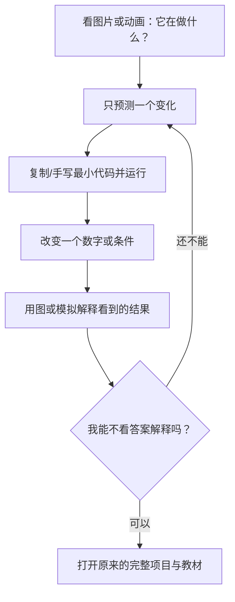
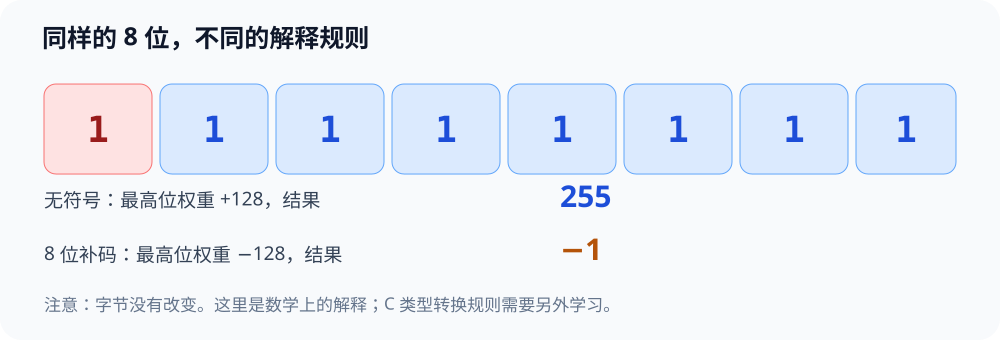

# 先玩再学：计算机系统基础的直观实验入口

> [!important] 这里才是新的起点
> 不要求先理解整章、先安装所有工具，也不把“完成大型项目”当作第一步。**先看一个现象 → 运行一个最小例子 → 改动一个条件 → 看图解释 → 想深入再读原来的长文档。**
>
> 学习进度按**自己能否预测和解释**判断，不按阅读页数、打卡天数判断。原有完整实验不删除，它们现在是进阶材料。

## 30 秒选入口

| 你现在想看什么 | 可直接进入 | 先得到什么 |
| --- | --- | --- |
| 程序为什么能跑 | [[微实验/00-源代码第一次运行\|微实验 00：第一次运行]] | 屏幕出现 `Hello, system!` |
| 二进制为什么能表示负数 | [[微实验/01-一串位两种数值\|微实验 01：八个位]] | 发现 `11111111` 可以读成 255 或 -1 |
| CPU 怎么执行加法 | [[微实验/02-函数调用与寄存器\|微实验 02：一次加法]] | 追踪“参数 → 计算 → 返回” |
| 其他章节的超小实验 | [[#所有项目的最小入口\|项目 3–10 导航]] | 不再被大型任务吓住 |

**先打开 [交互式实验室（独立 HTML）](visuals/先玩再学-系统实验室.html)**：0、1、2 三个实验有点击、预测、单步和即时反馈。HTML 是辅助模拟，不会真的调用编译器；真实证据仍来自 WSL。

## 一张图：把学习任务缩小到“看得见”

## 真实操作只需要什么

1. 先打开 WSL 的 Ubuntu 终端。若不能进入或不知如何保存文件，查看 [[自学文档0（补）-WSL 实操衔接手册]] 的第 1、4 章；其他配置暂时不必完成。
2. 每个小实验只需独立目录、短代码和一条编译运行命令。**不要一开始同时学 gcc、gdb、objdump、strace。**
3. 运行前选一个预期；运行后把它与屏幕输出对上。如果出错，保留完整错误信息，作为学习素材。
4. 看懂后再展开“为什么”，最后回到原自学文档。

> [!tip] Obsidian 兼容性
> 本页只用一级标题、二级标题、链接与标准 Mermaid 代码围栏；正文中的 `#include` 在代码围栏里。SVG 图片可直接放进 Obsidian；HTML 的 JavaScript 通常不能在普通 Markdown 预览里执行，请**在浏览器中打开 .html 文件**（VS Code Live Server 也可以）。在 GitHub 上点击 HTML 的 Raw/下载后本地打开也可以。交互文件不加载 CDN，不上传你的输入。

## 所有项目的最小入口

| 项目 | 第一眼先观察 | 超小实验 | 深入原文 |
| --- | --- | --- | --- |
| 0 编译与运行 | 一段文本如何变成输出 | [[微实验/00-源代码第一次运行\|从 C 到 Hello]] | [[自学文档0（下）-项目0核心内容-系统观察与工具入门]] |
| 1 数据表示 | 同一串位被两种方式解释 | [[微实验/01-一串位两种数值\|8 位解释器]] | [[自学文档1-项目1-数据表示与位运算]] |
| 2 机器级程序 | 加法结果如何回来 | [[微实验/02-函数调用与寄存器\|add 调用]] | [[自学文档2-项目2-机器级程序与函数栈]] |
| 3 简化 CPU | PC 每走一步寄存器怎样变 | [[微实验/03-三条指令的小CPU\|三步 CPU]] | [[自学文档3-项目3-简化CPU模拟]] |
| 4 链接 | 两个 C 文件怎样协作 | [[微实验/04-两个文件拼成程序\|两文件链接]] | [[自学文档4-项目4-链接与装载]] |
| 5 Cache | 两种数组访问顺序 | [[微实验/05-按顺序还是跳着访问\|访问顺序]] | [[自学文档5-项目5-程序优化与Cache]] |
| 6 进程 | 一个进程怎样产生两个执行分支 | [[微实验/06-一个程序两个进程\|fork]] | [[自学文档6-项目6-进程与异常控制流]] |
| 7 虚拟内存 | 两个变量的地址有什么不同 | [[微实验/07-变量住在哪里\|地址观察]] | [[自学文档7-项目7-虚拟内存与动态分配]] |
| 8 文件 I/O | 程序把一句话写到文件 | [[微实验/08-亲手写出一个文件\|文件写入]] | [[自学文档8-项目8-文件与系统IO]] |
| 9 网络 | 浏览器怎样收到本机回复 | [[微实验/09-本机第一个HTTP回复\|本机 HTTP]] | [[自学文档9-项目9-Socket与HTTP]] |
| 10 并发 | 两个执行任务怎样汇合 | [[微实验/10-两个线程会合\|线程入门]] | [[自学文档10-项目10-并发与同步]] |

## 三种学习深度，可以在任何位置停下

- **A：能看到。** 按步骤执行，认识输入与输出。零基础在这里停下完全可以。
- **B：能解释。** 先自己预测，改一个数字，使用 Mermaid、HTML 图解解释因果。
- **C：能研究。** 回到旧文档，用 gdb、objdump、strace、教材和完整项目验证机制。

### 例如：项目 1

最小目标不是“学完补码和溢出”，而是：**把一组 8 位看成无符号数得到 255，看成 8 位补码得到 -1。**

现在你只需要回答：**位有没有变？还是我们读取它的规则变了？** 有把握后才去读补码公式和 C 类型转换。

## 和旧课程的关系

原先的课程大纲、CS:APP 对照章节、完整项目、证据报告模板都保留。新的“微实验”是它们的**前置台阶**，不是替代系统学习。所有实验都鼓励你自己动手，不把运行截图或 AI 给出的解释当作独立掌握。参考资料总表：[[实验参考指南与可视化索引]]。

### 一分钟复盘模板

- 我原来以为：……
- 我实际看到了：……
- 我改了一个条件：……
- 现在能解释：……
- 暂时还不理解：……（这就是下一次实验入口）
