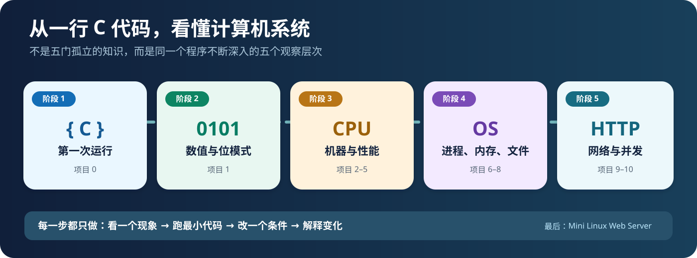
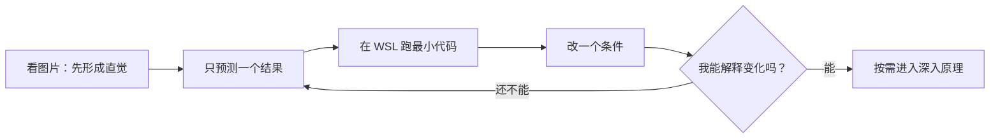

# 计算机系统基础｜从这里开始

> [!important] 新版交互式学习工作台（2026-10-21）
> **从 [System Lab 交互首页](index.html) 开始**：同一个页面依次体验 00 编译/运行、01 八位补码、02 寄存器单步。可以编辑数据、预测、得到即时反馈；真实 Linux 命令需要复制到你自己的 Ubuntu 执行。
> 互动记录只保存在浏览器，不等于独立掌握。原来的 [0–2 旧版交互模拟](visuals/先玩再学-系统实验室.html)、[3–10 观察板](visuals/进阶前的交互观察板.html) 和全部长文档仍然保留。
>

> **这里是整门课程的唯一总入口。** 原来的长篇自学文档、11 个微实验、HTML 交互实验室、Mermaid 图、CS:APP 阅读指南都没有删除，而是重新归类。**现在只需要选一个实验，不需要先读完资料。**
>
> 想要像网站一样点击学习？打开 **[可视化课程主页（HTML）](index.html)**（下载到本地，用浏览器打开；GitHub 本身不会执行 HTML 内的 JavaScript）。

## 现在从哪里开始？

### 今天只做一件事：让一段 C 程序运行

**[▶ 开始微实验 00：源代码第一次运行](微实验/00-源代码第一次运行.md)**

你只需要完成这三个动作：

1. **看图**：辨认 `hello.c`、`gcc`、`hello`、`./hello` 是什么。
2. **亲手运行**：复制微实验里的五行 C 代码与一条编译运行命令，在 WSL 终端看到 `Hello, system!`。
3. **改一处再运行**：把输出改成自己的话，先猜变化，再重新编译运行。

**最小通过标准：** 不看解释，能说出“写下源码 / 编译生成可执行文件 / 真正执行程序”的区别。

不想现在开 WSL？先打开 [项目 0–2 交互实验室](visuals/先玩再学-系统实验室.html)，选择「00 · 程序运行」，点击“下一步”观察整个过程。**HTML 只负责建立直觉，不算已经独立运行代码。**

> [!note] 学习进度说明
> 课程阶段记录目前把“从源文件到进程”设为**建议诊断起点**，尚未核实独立通过。本文不把“有文档”“看过图”视作完成，也没有替你更新真实学习进度。

## 走完一个最小实验，接下来去哪？

| 阶段 | 从什么现象开始 | 最先做哪个微实验 | 深入到什么程度 |
| --- | --- | --- | --- |
| **1 · 程序能跑** | 写下的 C 文本怎么变成屏幕输出？ | [00 · 源代码第一次运行](微实验/00-源代码第一次运行.md) | [编译与运行完整实验](自学文档0（下）-项目0核心内容-系统观察与工具入门.md) |
| **2 · 位代表什么** | 为什么相同 8 位能表示 255 和 -1？ | [01 · 一串位两种数值](微实验/01-一串位两种数值.md) | [CS:APP 第二章数据表示](自学文档1-项目1-数据表示与位运算.md) |
| **3 · 机器怎么做** | 一次加法，CPU 怎样取值、计算并返回？ | [02 · 函数调用与寄存器](微实验/02-函数调用与寄存器.md) | [项目 2–5：汇编、CPU、链接、Cache](00-先玩再学-直观实验入口.md) |
| **4 · 系统怎么管** | 两个进程和内存、文件怎样协作？ | [06 · 一个程序两个进程](微实验/06-一个程序两个进程.md) | [项目 6–8：进程、虚拟内存、I/O](00-先玩再学-直观实验入口.md) |
| **5 · 程序怎么通信** | 浏览器请求如何到达服务端并返回？ | [09 · 本机第一个 HTTP 回复](微实验/09-本机第一个HTTP回复.md) | [项目 9–10：Socket、HTTP、并发](00-先玩再学-直观实验入口.md) |

阶段 3 实际包含 **02、03、04、05** 四个微实验；阶段 4 包含 **06、07、08**；阶段 5 包含 **09、10**。不必在本页面一次展开它们。想查看全部 11 个实验时再打开 [完整微实验目录](00-先玩再学-直观实验入口.md)。

## 每个微实验固定这样学

不要求第一次就从微观机制推导全部现象。一个实验先做到“**能观察到什么、改变什么、为什么会变**”。

## 按需拿资料，不要全部同时打开

| 你遇到的情况 | **只打开这一个资源** |
| --- | --- |
| 还不想写代码，先观察现象 | [0–2 交互实验室](visuals/先玩再学-系统实验室.html) |
| 对 fork、Cache、HTTP 等想先用鼠标探索 | [3–10 交互观察板](visuals/进阶前的交互观察板.html) |
| 不知道如何进入 WSL，或者怎样创建文件 | [WSL 实操衔接手册](自学文档0（补）-WSL%20实操衔接手册.md) |
| 想知道 CS:APP 具体该读哪一节 | [教材与参考资料索引](实验参考指南与可视化索引.md) |
| 准备挑战完整项目与最终 Web Server | [课程大纲与前言](计算机系统基础课程大纲与前言.md) |

**请避免**“今天先读 5 篇文档，再准备实验”。优先把今天的问题变成一个具体的可观察现象。

## 一分钟复盘（可复制到 Obsidian）

- 我今天改变了：……
- 原来预测：……
- 实际看到了：……
- 我现在能解释：……
- 下一步只想弄清楚：……

课程目标：**用一段真实 C 程序串联数据表示、机器执行、操作系统与网络。** 从“会执行”逐渐走向“会解释、会验证、会迁移”，不是要求你一下子掌握所有工具。

---

Obsidian 可以直接预览本 Markdown 与 SVG 图片。交互式 HTML 需要在浏览器打开本地文件（可用 VS Code Live Server）；GitHub 的 HTML 文件页面不会直接执行交互逻辑。
