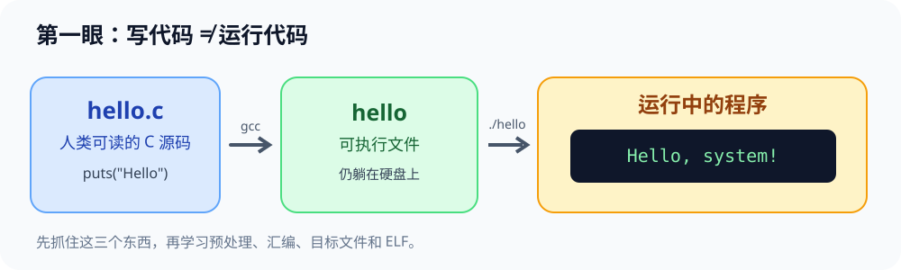
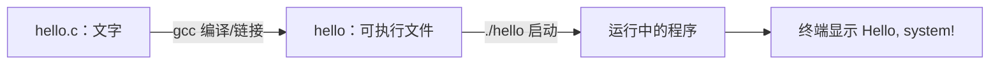

# 微实验 00：源代码第一次运行

> [!success] 只做一件事
> 把 5 行 C 程序变成屏幕上的 `Hello, system!`。先不用理解 ELF、汇编、进程调度。

## 先看图：程序并不是自己跑起来的





**直觉类比**：`hello.c` 像食谱；`gcc` 像把食谱转成可以执行的机器操作；运行 `./hello` 才是“真正做菜”。类比只帮助入门，进阶再研究中间步骤。

## 做之前猜一下

以下哪个命令会让屏幕打印 `Hello, system!`？

- A. `gcc hello.c -o hello`
- B. `./hello`（假设已经编译成功）

猜完再执行。也可打开 [交互实验：编译流水线](../visuals/先玩再学-系统实验室.html)。

## 直接在 WSL 运行

在 Ubuntu 终端粘贴下方代码块（`EOF` 前后要单独占一行）：

```bash
mkdir -p ~/cs-system/tiny0 && cd ~/cs-system/tiny0
cat > hello.c <<'EOF'
#include <stdio.h>
int main(void) {
    puts("Hello, system!");
    return 0;
}
EOF
gcc hello.c -o hello && ./hello
```

预计最后一行是：

```text
Hello, system!
```

**最小验证**：上面是一条连接的命令：`gcc hello.c -o hello` 负责生成文件；`./hello` 才真正运行。`&&` 代表前一条成功后再执行后一条。

## 只改变一件事

把 `Hello, system!` 改为你自己的一句话，然后**重新执行最后一行编译运行命令**，观察输出是否改变。若仅编辑源代码、直接执行旧的 `./hello`，输出会不会自动更新？先猜再试。

## 如果卡住

- `gcc: command not found`：需要先查看 [[../自学文档0（补）-WSL 实操衔接手册\|WSL 实操手册]] 的工具安装段落。
- `hello.c: No such file`：确认已进入 `~/cs-system/tiny0`，执行 `pwd` 和 `ls`。
- `./hello: No such file`：先确认编译成功，使用 `ls -l` 看可执行文件是否存在。

## 你学到了什么（只需说出两个区别）

1. 源文件是**文本**；可执行文件是编译/链接后生成的程序文件。
2. **生成程序**与**运行程序**是两件不同的事。

下一阶：[打开交互实验室](../visuals/先玩再学-系统实验室.html) → 在流程图里逐步展开预处理/汇编/链接；原文深入：[[../自学文档0（下）-项目0核心内容-系统观察与工具入门\|项目 0 完整实验]]，教材 CS:APP 第 1 章。

### 迁移题

如果你修改代码却不重新编译，旧的可执行文件会变吗？设计一个最短操作验证，不看提示先写预测。
