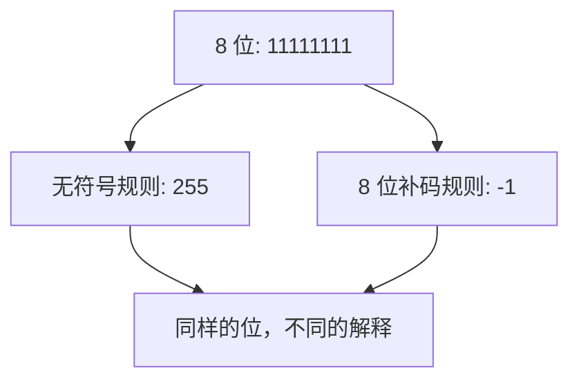

# 微实验 01：一串位，两种数值

> [!success] 只做一件事
> 固定 8 位：`11111111` 不变。用无符号解释得到 255，用 8 位补码解释得到 -1。

## 先看同一串位


**请盯住上面 8 个格子：** 两次解释之间没有任何一位发生变化。变的是读取规则。无符号表示 128+64+32+16+8+4+2+1=255；8 位补码的最高位权重为 -128，其余位权相同，合计 -1。



## 先在互动图里改变最后一位

[打开互动的 8 位数据表](../visuals/先玩再学-系统实验室.html)。尝试预设 `0x7F`、`0x80`、`0xFF`：先说无符号和补码各是多少，再揭晓。交互图只是**数学解释模拟**，不是浏览器中真的运行 C。

## 在 WSL 做真实的小实验

```bash
mkdir -p ~/cs-system/tiny1 && cd ~/cs-system/tiny1
cat > bits.c <<'EOF'
#include <stdint.h>
#include <stdio.h>
int main(void) {
    uint8_t bits = 0xFF;
    int unsigned_value = bits;
    int signed_value = (bits & 0x80) ? (int)bits - 256 : (int)bits;
    printf("hex=0x%02X unsigned=%d signed8=%d\n",
           (unsigned)bits, unsigned_value, signed_value);
}
EOF
gcc -std=c11 -Wall -Wextra bits.c -o bits && ./bits
```

预期：`hex=0xFF unsigned=255 signed8=-1`。

**细节**：代码没有把 `uint8_t` 强制转为 `int8_t`，而是明确按“8 位补码规则”自己算；这样不依赖超出有符号范围时的实现定义转换。真实 C 类型转换规则是下一阶段的内容。

## 只改一个十六进制数

把 `0xFF` 改成 `0x80`，预测应该得到什么；再改为 `0x7F`。每次修改后重新编译执行。

- `0x7F` 对应 127 / 127。
- `0x80` 对应 128 / -128。
- `0xFF` 对应 255 / -1。

## 现在才给公式

对于 8 位位模式，先按照无符号规则得到 `u`。按 8 位补码解释：若 `u < 128`，结果就是 `u`；否则结果是 `u - 256`。注意 256 是 **2 的 8 次方**，不是“把二进制数减去八”。

你需要能回答：是 8 位的最高位“永远代表负数”，还是**在使用补码解释时**它才具有负权重？

下一阶：[[../自学文档1-项目1-数据表示与位运算\|项目 1 完整自学文档]]，重点 `2.1` 与 `2.2`；以后再继续字节序、溢出、浮点。不要直接跳到浮点。
