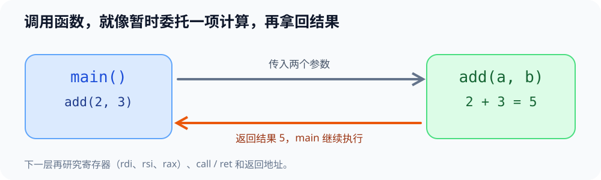
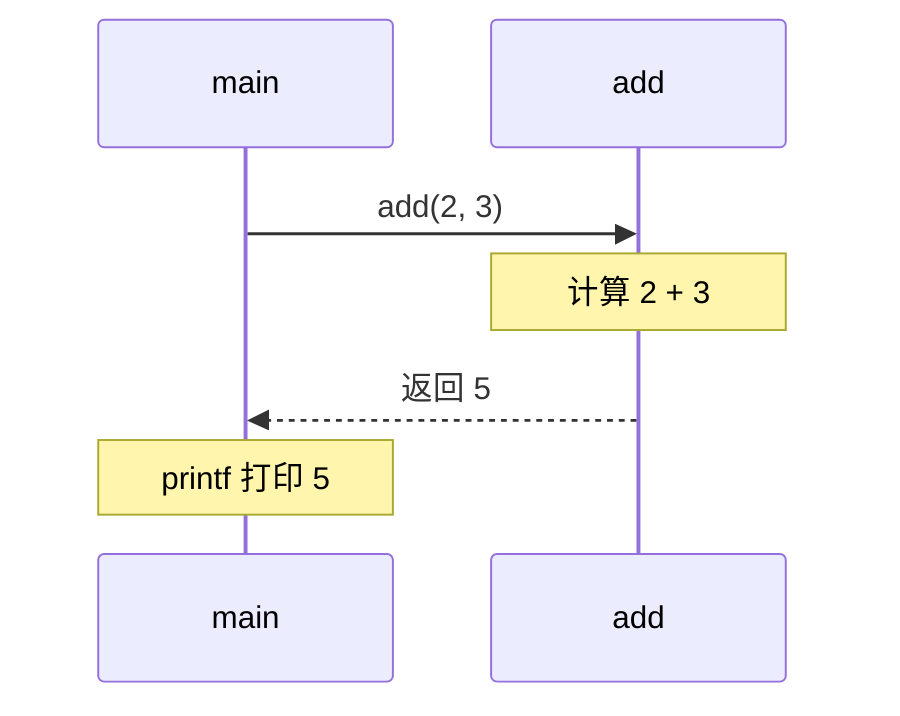

# 微实验 02：一次加法，函数怎么回来

> [!important] 本实验优先走代码与终端
> **[直接进入 02 号代码工作台](../index.html#lab-2)**：先在浏览器编辑一行真实源码或构建命令，复制到 Ubuntu 终端运行，再把实际输出或报错带回来核对。下方动画只是帮助你解释机制，不会替你执行 GCC。

> [!tip] 学习导航
> [← 返回课程总览](../README.md) ｜ [打开五阶段图形化首页](../index.html) ｜ 今天只做本页这一个最小实验。

> [!success] 只做一件事
> 调用 `add(2, 3)`，得到 `5`。先理解“传入参数 → 算出结果 → 返回主程序”，之后才看汇编与栈帧。

## 先看可视化





## 用 WSL 跑起来

```bash
mkdir -p ~/cs-system/tiny2 && cd ~/cs-system/tiny2
cat > add.c <<'EOF'
#include <stdio.h>
long add(long a, long b) {
    return a + b;
}
int main(void) {
    printf("%ld\n", add(2, 3));
    return 0;
}
EOF
gcc -O0 -g add.c -o add && ./add
```

预期输出：`5`。

把 `add(2, 3)` 改成 `add(8, 4)`，重新编译运行。再问自己：为什么不需要在 main 中写一遍加法？

## 交互模拟 CPU 状态（不要求先懂汇编）

[打开交互实验室 → 项目 2](../visuals/先玩再学-系统实验室.html)，设置两个参数，点击“下一条指令”，观察 `rdi`、`rsi`、`rax`。这是一段**教学示意指令**，真实 GCC 的实际指令顺序会随编译环境改变。

## 想再向机器靠近一步（可选）

如果已经有 GDB，下面命令让函数入口暂停、显示参数和调用栈：

```bash
gdb -q -batch -ex 'break add' -ex run -ex 'info args' -ex bt ./add
```

`info args` 应能看到 `a` 和 `b` 的实际值。无需这一步也可以完成 A 级目标。参数经寄存器还是内存传递、返回地址在何处属于 B/C 级任务；在 Linux x86-64 的 System V ABI 下，前两个整数/指针参数通常在 `rdi` / `rsi`，整数返回值常在 `rax`。

## 现在先区分三个角色

- **源代码函数**：人写的规则。
- **机器指令**：CPU 实际执行的动作。
- **寄存器**：CPU 内部的小型暂存位置，用来装参数、中间值或结果。

旧材料深入：[[自学文档2-项目2-机器级程序与函数栈|项目 2 完整自学文档]]，重点“寄存器、call/ret”，再学栈帧与调试。试着解释：若换成 add(8,4)，哪一些机器**数值**可能变化，哪一些“参数/返回”**角色**不变？
