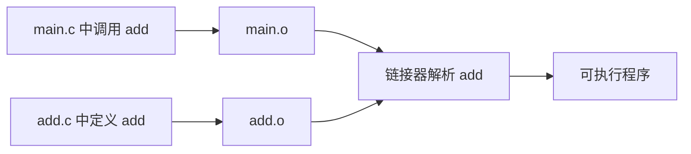

# 微实验 04：两个文件拼成程序

> [!important] 本实验优先走代码与终端
> **[直接进入 04 号代码工作台](../visuals/进阶前的交互观察板.html#lab-4)**：先在浏览器编辑一行真实源码或构建命令，复制到 Ubuntu 终端运行，再把实际输出或报错带回来核对。下方动画只是帮助你解释机制，不会替你执行 GCC。

> [!tip] 学习导航
> [← 返回课程总览](../README.md) ｜ [打开五阶段图形化首页](../index.html) ｜ 今天只做本页这一个最小实验。

> [!success] 今天的最小目标
> 把一个加法函数装到另一个 C 文件里，让 main 调用它。 不必先做原课程的大项目。

## 先预测一个现象

只有 main.c，不把 add.c 一起交给 gcc，会在哪一步报错？

## 先看一张机制图



> [!note] 这是简化模型
> 这张图只展示本实验关心的因果顺序，没有把真实系统的全部机制画进来。

## 在 WSL 只做一个实验

```bash
mkdir -p ~/cs-system/tiny4 && cd ~/cs-system/tiny4
cat > main.c <<'EOF'
#include <stdio.h>
int add(int x, int y);
int main(void) {
    printf("%d\n", add(2, 3));
    return 0;
}
EOF
cat > add.c <<'EOF'
int add(int x, int y) { return x + y; }
EOF
gcc main.c add.c -o joined && ./joined

```

**你应该看见：**

```text
5
```

> [!tip] 小提示
> 如果出现“命令不存在”“文件不存在”，先用 `pwd`、`ls`、`gcc --version` 定位问题；WSL 基础见 [[自学文档0（补）-WSL 实操衔接手册]]。

## 改一个条件，再试

只执行 gcc main.c -o broken，观察提示 undefined reference to add；再把 add.c 加回来。

## 现在解释，不必马上记全套概念

**编译**分别理解文件里是什么，**链接**再把“调用 add”和“add 的定义”对应起来。最开始不必记符号表和重定位。

**自查**：你能不看答案说出“什么东西变了 → 为什么输出变了”吗？能就完成了这个微实验；不能就回去改一次输入。

## 要深入时再打开

- 原完整材料：[[自学文档4-项目4-链接与装载]]。
- 课程索引：[[00-先玩再学-直观实验入口]]。
- 学习方式：先做到“看到”，再做到“预测与解释”，最后才进入完整系统项目。查教材章节用 [[实验参考指南与可视化索引]]。
