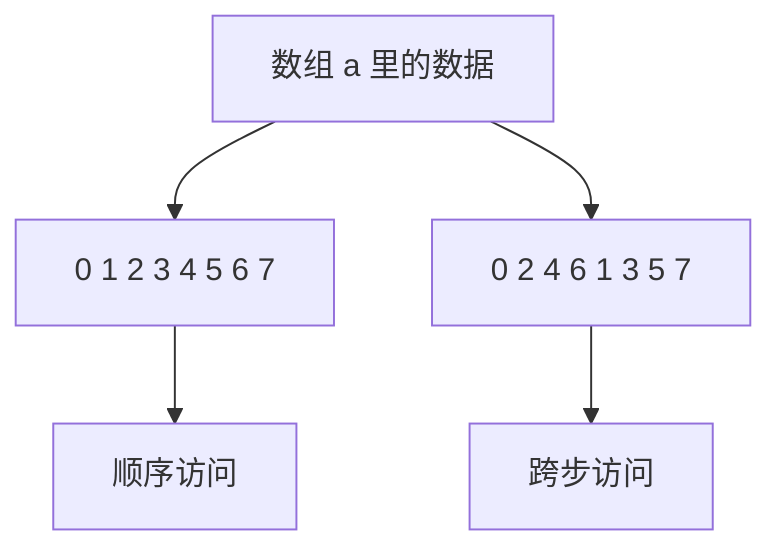

# 微实验 05：按顺序还是跳着访问

> [!tip] 学习导航
> [← 返回课程总览](../README.md) ｜ [打开五阶段图形化首页](../index.html) ｜ 今天只做本页这一个最小实验。

> [!tip] 先点击交互模型，再运行代码
> 打开 [项目 3–10 交互观察板](../visuals/进阶前的交互观察板.html)，选本项目，改变一个条件并逐步观察。**它是模拟，不替代下面的真实 WSL 实验。**

> [!success] 今天的最小目标
> 先把访问的顺序看出来，再问 Cache 为什么喜欢某些顺序。 不必先做原课程的大项目。

## 先预测一个现象

同一个 a[8]，按顺序读和先偶数下标后奇数下标读，输出顺序相同吗？

## 先看一张机制图



> [!note] 这是简化模型
> 这张图只展示本实验关心的因果顺序，没有把真实系统的全部机制画进来。

## 在 WSL 只做一个实验

```bash
mkdir -p ~/cs-system/tiny5 && cd ~/cs-system/tiny5
cat > demo.c <<'EOF'
#include <stdio.h>
int main(void) {
    int a[8]={0,1,2,3,4,5,6,7};
    for (int i=0;i<8;i++) printf("%d ",a[i]);
    puts("");
    for (int start=0;start<2;start++)
        for (int i=start;i<8;i+=2) printf("%d ",a[i]);
    puts("");
}
EOF

gcc demo.c -o demo && ./demo
```

**你应该看见：**

```text
0 1 2 3 4 5 6 7
0 2 4 6 1 3 5 7
```

> [!tip] 小提示
> 如果出现“命令不存在”“文件不存在”，先用 `pwd`、`ls`、`gcc --version` 定位问题；WSL 基础见 [[自学文档0（补）-WSL 实操衔接手册]]。

## 改一个条件，再试

把 i+=2 改成 i+=4 后，试着画出输出顺序；提示：起点也要对应调整才能遍历所有元素。

## 现在解释，不必马上记全套概念

输出顺序不同**不能直接证明 Cache 更快或更慢**。这是观察访问模式的第一级；速度差异需要大量数据、重复测量和控制变量。

**自查**：你能不看答案说出“什么东西变了 → 为什么输出变了”吗？能就完成了这个微实验；不能就回去改一次输入。

## 要深入时再打开

- 原完整材料：[[自学文档5-项目5-程序优化与Cache]]。
- 课程索引：[[00-先玩再学-直观实验入口]]。
- 学习方式：先做到“看到”，再做到“预测与解释”，最后才进入完整系统项目。查教材章节用 [[实验参考指南与可视化索引]]。
