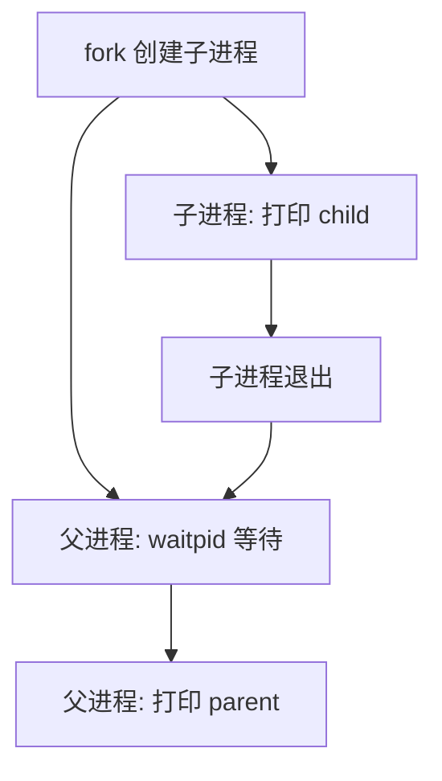

# 微实验 06：一个程序两个进程

> [!tip] 学习导航
> [← 返回课程总览](../README.md) ｜ [打开五阶段图形化首页](../index.html) ｜ 今天只做本页这一个最小实验。

> [!tip] 先点击交互模型，再运行代码
> 打开 [项目 3–10 交互观察板](../visuals/进阶前的交互观察板.html#lab-6)，页面会直接定位到本实验；先预测、改变一个条件，再观察结果。**它是模拟，不替代下面的真实 WSL 实验。**

> [!success] 今天的最小目标
> 观察 fork 之后出现两条执行路线：孩子执行一段，家长等待孩子结束。 不必先做原课程的大项目。

## 先预测一个现象

下面代码最后预计打印几行？每行的先后顺序为什么稳定？

## 先看一张机制图



> [!note] 这是简化模型
> 这张图只展示本实验关心的因果顺序，没有把真实系统的全部机制画进来。

## 在 WSL 只做一个实验

```bash
mkdir -p ~/cs-system/tiny6 && cd ~/cs-system/tiny6
cat > demo.c <<'EOF'
#include <stdio.h>
#include <unistd.h>
#include <sys/wait.h>
int main(void) {
    pid_t p = fork();
    if (p == 0) { puts("child"); return 0; }
    if (p > 0) { waitpid(p, NULL, 0); puts("parent"); }
    else perror("fork");
    return 0;
}
EOF

gcc demo.c -o demo && ./demo
```

**你应该看见：**

```text
child
parent
```

> [!tip] 小提示
> 如果出现“命令不存在”“文件不存在”，先用 `pwd`、`ls`、`gcc --version` 定位问题；WSL 基础见 [[自学文档0（补）-WSL 实操衔接手册]]。

## 改一个条件，再试

把 waitpid 暂时去掉，多次运行观察顺序是否仍能保证；再恢复它。

## 现在解释，不必马上记全套概念

fork 返回两次，但在两个**不同进程**中。waitpid 让父进程等待子进程结束。没有 waitpid 时输出顺序不再由程序保证。

**自查**：你能不看答案说出“什么东西变了 → 为什么输出变了”吗？能就完成了这个微实验；不能就回去改一次输入。

## 要深入时再打开

- 原完整材料：[[自学文档6-项目6-进程与异常控制流]]。
- 课程索引：[[00-先玩再学-直观实验入口]]。
- 学习方式：先做到“看到”，再做到“预测与解释”，最后才进入完整系统项目。查教材章节用 [[实验参考指南与可视化索引]]。
