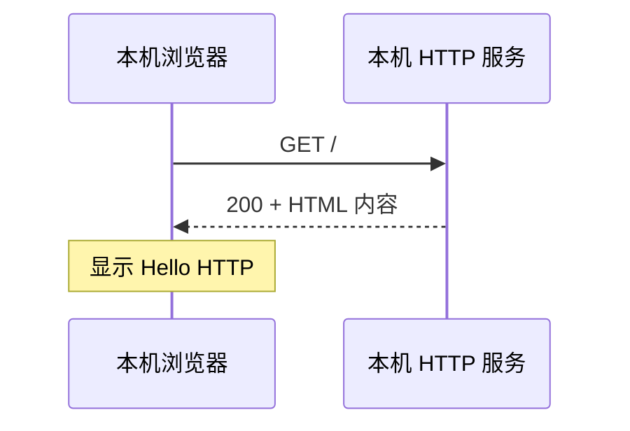

# 微实验 09：本机第一个HTTP回复

> [!success] 今天的最小目标
> 不必一上来自己写 Socket 服务器。先让浏览器访问一个只在自己电脑运行的最小网页。 不必先做原课程的大项目。

## 先预测一个现象

浏览器输入 http://127.0.0.1:8765 时，谁负责发送请求、谁负责返回内容？

## 先看一张机制图



> [!note] 这是简化模型
> 这张图只展示本实验关心的因果顺序，没有把真实系统的全部机制画进来。

## 在 WSL 只做一个实验

```bash
mkdir -p ~/cs-system/tiny9 && cd ~/cs-system/tiny9
printf '<h1>Hello HTTP</h1>\n' > index.html
python3 -m http.server 8765 --bind 127.0.0.1
```

**保持终端运行**，然后从浏览器打开 `http://127.0.0.1:8765/`。如果端口已占用，可换为未占用的端口，并同步修改浏览器 URL。

**你应该看见：**

```text
浏览器出现 Hello HTTP
```

> [!tip] 小提示
> 如果出现“命令不存在”“文件不存在”，先用 `pwd`、`ls`、`gcc --version` 定位问题；WSL 基础见 [[自学文档0（补）-WSL 实操衔接手册]]。

## 改一个条件，再试

修改 index.html，刷新浏览器；观察内容变化。然后在运行服务的终端按 Ctrl+C 关闭。

## 现在解释，不必马上记全套概念

这里先借 Python 的 HTTP 服务观察完整请求响应；它只是入门观察，不等于你已经编写了 C Socket 服务器。端口只绑定 127.0.0.1，不主动向局域网开放。

**自查**：你能不看答案说出“什么东西变了 → 为什么输出变了”吗？能就完成了这个微实验；不能就回去改一次输入。

## 要深入时再打开

- 原完整材料：[[自学文档9-项目9-Socket与HTTP]]。
- 课程索引：[[00-先玩再学-直观实验入口]]。
- 学习方式：先做到“看到”，再做到“预测与解释”，最后才进入完整系统项目。查教材章节用 [[实验参考指南与可视化索引]]。
