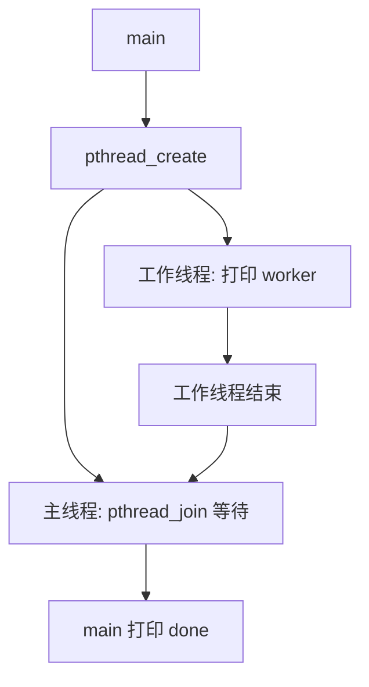

# 微实验 10：两个线程会合

> [!tip] 学习导航
> [← 返回课程总览](../README.md) ｜ [打开五阶段图形化首页](../index.html) ｜ 今天只做本页这一个最小实验。

> [!tip] 先点击交互模型，再运行代码
> 打开 [项目 3–10 交互观察板](../visuals/进阶前的交互观察板.html)，选本项目，改变一个条件并逐步观察。**它是模拟，不替代下面的真实 WSL 实验。**

> [!success] 今天的最小目标
> 在主程序里启动一个工作线程，等它执行完再打印 main done。 不必先做原课程的大项目。

## 先预测一个现象

如果不等待工作线程结束，主程序是否保证它总能先输出？

## 先看一张机制图



> [!note] 这是简化模型
> 这张图只展示本实验关心的因果顺序，没有把真实系统的全部机制画进来。

## 在 WSL 只做一个实验

```bash
mkdir -p ~/cs-system/tiny10 && cd ~/cs-system/tiny10
cat > demo.c <<'EOF'
#include <pthread.h>
#include <stdio.h>
void *work(void *arg) {
    (void)arg; puts("worker"); return NULL;
}
int main(void) {
    pthread_t t;
    if (pthread_create(&t,NULL,work,NULL) != 0) return 1;
    if (pthread_join(t,NULL) != 0) return 1;
    puts("main done");
}
EOF

gcc -pthread demo.c -o demo && ./demo
```

**你应该看见：**

```text
worker
main done
```

> [!tip] 小提示
> 如果出现“命令不存在”“文件不存在”，先用 `pwd`、`ls`、`gcc --version` 定位问题；WSL 基础见 [[自学文档0（补）-WSL 实操衔接手册]]。

## 改一个条件，再试

尝试把主线程的一次 puts 移到 pthread_join 前面，观察它与 worker 的打印顺序是否稳定。

## 现在解释，不必马上记全套概念

线程共享同一进程的大部分地址空间，但执行顺序由调度影响。join 保证等待线程结束；共享变量同步（互斥锁）是下一阶段的任务。

**自查**：你能不看答案说出“什么东西变了 → 为什么输出变了”吗？能就完成了这个微实验；不能就回去改一次输入。

## 要深入时再打开

- 原完整材料：[[自学文档10-项目10-并发与同步]]。
- 课程索引：[[00-先玩再学-直观实验入口]]。
- 学习方式：先做到“看到”，再做到“预测与解释”，最后才进入完整系统项目。查教材章节用 [[实验参考指南与可视化索引]]。
