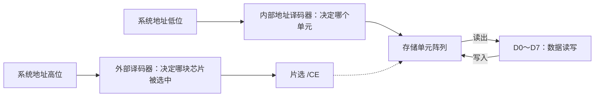
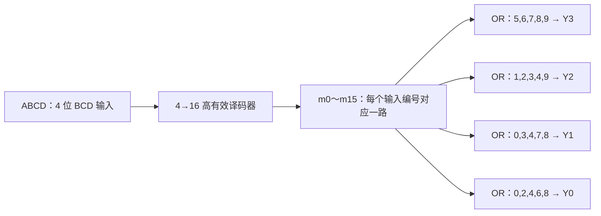

# 译码器、存储器寻址与 8421BCD→余三码

> [!abstract] 本文定位
> [[lessons/数字逻辑与系统/课程阶段#阶段 3｜组合模块|阶段 3 · 组合模块]] 的可复用学习笔记。按照**功能 → 接口 → 有效电平 → 真值表/最小项 → 地址或电路 → 反例检查**来读。
> 当天对话的真实学习进度、局部答题与尚未独立验收的部分见 [[calendar/2026-10-18#数字逻辑与系统｜译码器、存储寻址与余三码（互动解题）|2026-10-18 · 学习记录]]。以下是归纳讲解，不代表已经独立完成全部题目。

## 1. 首先分清：系统地址、片内地址、数据与片选

| 信号 | 回答的问题 | 512×8 芯片中的角色 |
| --- | --- | --- |
| 系统地址 A0～A11 | 整个系统要访问哪个地址？ | 12 位系统地址，总共最多 4096 个字节地址 |
| 片内地址 A0～A8 | 已选中的这块芯片访问哪个单元？ | 9 位 → 2⁹=512 个单元 |
| D0～D7 | 该地址读/写的数据是什么？ | 8 位数据总线，不决定存储单元编号 |
| 片选 $\overline{E}$ / `/CE` | 哪一块芯片响应访问？ | 低有效时，0 选中、1 不选中 |
| 译码器使能 $\overline{G}$ 等 | 译码器当前是否工作？ | 先满足使能，才能谈选中了哪个译码输出 |

**512×8 = 512 个单元 × 每单元 8 位 = 4096 bit = 512 byte**。不要将“8 位数据宽度”误当成“需要 8 根地址线”。地址线数量取决于**单元数**：`log₂ 512 = 9`。

同一个名称可以出现在不同器件上：74LS139 的 `A1` 是它自己的第 1 位**选择输入**，图中接**系统 A11**；存储芯片 `A1` 是该芯片自己的第 1 位**片内地址输入**，图中接**系统 A1**。是否为同一信号由接线决定，不由引脚同名决定。

### 两级译码思想

外部译码器只负责选芯片；芯片内部的地址译码电路选存储单元。**译码器本身是组合逻辑，不会保存上一次写入的数据**；真正存储由存储单元实现。

## 2. 74LS139 选择 III 号 512×8 存储芯片

题图所示连接（以图中一组 2→4 译码单元为准）：

- 系统 A11 → 74LS139 的选择输入 `A1`；
- 系统 A9 → 74LS139 的选择输入 `A0`；
- 系统 A10 **经过非门** → 74LS139 低电平有效使能 $\overline{G}$；
- 74LS139 的低有效输出 $\overline{Y}_3$ → III 号存储芯片的低有效片选 $\overline{E}$；
- A0～A8 → III 号芯片的片内地址端；D0～D7 → 数据线。

### 2.1 先解使能，再解选择

使能条件：$\overline{G}=\neg A_{10}=0$，因此 **A10=1**。

对 2→4 译码器而言，选中第 3 路必须选择输入 `A1A0=11`，因此系统 **A11=1、A9=1**。

三根系统高位按从高到低组合：

$$
A_{11}A_{10}A_9=111
$$

剩余 A8～A0 共 9 位在芯片内部自由取值：

$$
\underbrace{111}_{\text{高 3 位片选}}\ \underbrace{000000000\sim111111111}_{\text{低 9 位片内寻址}}
$$

- 最小地址：`1110 0000 0000₂ = E00H`；
- 最大地址：`1111 1111 1111₂ = FFFH`；
- 地址数量：`0xFFF - 0xE00 + 1 = 512`。

**III 号芯片的系统地址范围：E00H～FFFH（两端均包含）。** `000H～1FFH` 是从该芯片内部角度看的相对地址范围；不要与系统地址混淆。

### 2.2 通用地址计算模板

1. 辨认每个引脚属哪个器件、哪个信号有小圆圈或上划线（低有效）。
2. 解**使能条件**，得到部分系统地址位的固定值。
3. 从设备连接的 `Yk` 或 `Y̅k` 确定**选择输入二进制编号**。
4. 将固定值写回真实的**系统地址位次序**，剩余未参与片选的位填 `X`。
5. `X` 全 0 得下界，全 1 得上界；二进制每 4 位一组转十六进制。
6. 检查范围大小，确认芯片容量/设备占用地址数。还要留意非连续译码条件会产生**多个离散地址区间**，不可随意写成连续范围。

## 3. 3→8 译码器及设备 A 的地址计算

另一题图里：译码器输入 `A2/A1/A0` 分别由**系统 A5/A4/A3**驱动；低有效使能 $\overline{G}_{2A}$ 接系统 A6，$\overline{G}_{2B}$ 接系统 A8；`G1` 由 A7、A9 经图中的**小矩形逻辑模块**驱动；设备 A 接 $\overline{Y}_3$。

> [!warning] 题图的关键不确定性
> A7、A9 到 G1 的矩形**未显示可辨认的门功能标记**。因此只凭现有图像无法无条件确定使能逻辑，也就不能唯一确定完整地址范围。下面 **仅在该模块是二输入与门** 的假设下演示计算。若为或门、与非门或其他功能，必须重新列使能条件，不能沿用结论。

**假设为与门时**：`G1=A7·A9=1` → A7=A9=1；两路低有效使能还要求 A6=0、A8=0。因此系统 A9～A6=`1010`。

- 整个译码器可选中的地址：`1010 XXXXXX₂`（这里固定前四位；系统地址共 10 位）→ **280H～2BFH**。
- 设备 A 接 $\overline{Y}_3$，第 3 路要求译码器输入 `A2A1A0=011`，即系统 A5A4A3=`011`。
- 系统 A9～A0 写为 `1010 011 XXX₂`；`XXX` 全 0 时 `10 1001 1000₂=298H`，全 1 时 `10 1001 1111₂=29FH`。
- 因而**在上述假设下**设备 A 占 **298H～29FH**，共 8 个地址。

**思考**：第 3 路 $\overline{Y}_3$ 为什么是 `011`，而不是 `110`？因为应按译码器自己的 `A2A1A0` 顺序写第 3 路编号，而非按系统 A3/A4/A5 的出现顺序倒过来读。

## 4. 用 4→16 译码器把 8421BCD 转换为余三码

### 4.1 编码规则

8421BCD 用四位数表示十进制的 0～9。**余三码 = 对应十进制数字 + 3，再写成四位二进制**。例如十进制 `4`：BCD `0100` → 余三码 `0111`。

设输入 `ABCD` 为 8421BCD（A 最高位），输出 `Y3Y2Y1Y0` 为余三码：

| 十进制 | ABCD | Y3Y2Y1Y0 |
| --- | --- | --- |
| 0 | 0000 | 0011 |
| 1 | 0001 | 0100 |
| 2 | 0010 | 0101 |
| 3 | 0011 | 0110 |
| 4 | 0100 | 0111 |
| 5 | 0101 | 1000 |
| 6 | 0110 | 1001 |
| 7 | 0111 | 1010 |
| 8 | 1000 | 1011 |
| 9 | 1001 | 1100 |

`1010～1111` 不是合法 8421BCD 输入：若题目不要求处理非法码，设计时可视为**无关项**；但硬件在这些输入下仍会产生电平，不能误认为天然“不输出”。

### 4.2 从真值表读出各输出为 1 的行

记高有效 4→16 译码器的最小项输出为 `m0～m15`。输入是十进制编号 `i` 时，**恰有 `mi=1`**。

$$
\begin{aligned}
Y_3 &= m_5+m_6+m_7+m_8+m_9 \\
Y_2 &= m_1+m_2+m_3+m_4+m_9 \\
Y_1 &= m_0+m_3+m_4+m_7+m_8 \\
Y_0 &= m_0+m_2+m_4+m_6+m_8
\end{aligned}
$$

`+` 表示逻辑或（OR），非算术加法。对每个输出，只要将真值表里**该列为 1 的所有行对应的最小项接入或门**即可。

**若器件是 74LS154 之类低电平有效的 4→16 译码器**，它给出的对应端是 $\overline{Y}_i$：被选中的一路为 0。此时可把每组列出的低有效输出连接到**多输入 NAND** 门，得到相同的高有效余三码输出，例如 $Y_3=\neg(\overline{Y}_5\cdot\overline{Y}_6\cdot\overline{Y}_7\cdot\overline{Y}_8\cdot\overline{Y}_9)$。实际画图还须满足器件使能有效条件及可用门输入数；多级门可实现多输入运算。

### 4.3 核对一组输入

`ABCD=0100`（十进制 4），译码器高有效输出只有 `m4=1`。在四组表达式里：
- Y3 不含 m4 → 0；
- Y2 含 m4 → 1；
- Y1 含 m4 → 1；
- Y0 含 m4 → 1。

因此输出 `0111`，与 `4+3=7` 一致。

## 5. 为什么“译码器 + 逻辑门”能实现任意组合逻辑函数？

一个具有 `n` 个输入的布尔函数，其输入共有 `2^n` 种组合；一个 `n→2^n` 高有效译码器能够分别识别每种组合，生成对应的最小项：

$$
m_i=1\iff \text{当前输入恰好等于编号 }i
$$

对于任意指定的真值表，函数只需对“输出=1”的那些行对应的最小项做逻辑或：

$$
F=\bigvee_{\{i:F(i)=1\}} m_i
$$

这就是**最小项之和（标准与或式）**。多个输出可以共用同一译码器，各自用不同的或门组合。

举例：两个输入 A、B，2→4 译码器给出
$$
m_0=\bar A\bar B,\quad m_1=\bar A B,\quad
m_2=A\bar B,\quad m_3=AB
$$

异或只在 `01` 或 `10` 时输出 1，故 `A⊕B=m1+m2`。这把三个视角统一起来：

**功能要求 / 真值表 ⇄ 最小项表达式 ⇄ 译码器 + 门电路**。

它能实现任意**确定的组合逻辑真值表**；但这不意味着译码器能单独存储状态，也不保证门数最少。若追求减少器件数量，可进一步用布尔化简、卡诺图、MUX 实现等方法优化。

## 6. 自检题（先独立推导）

1. **74LS139 变式**：仍要求 A10=1，但芯片改接到 $\overline{Y}_2$，且选择输入仍为 A11→A1、A9→A0。求系统地址上下界。（检查高三位在系统中的真实顺序。）
2. **低有效理解**：74LS154 输入对应 m4 时，$\overline{Y}_4$ 的电平是多少？为什么不能直接把低有效各输出送入普通 OR 门得到上文公式？
3. **译码器与存储器**：假设一个 1024×8 芯片需要几位片内地址？D0～D7 的功能是否改变？
4. **组合函数构造**：2→4 高有效译码器如何实现等价函数 XNOR（同或）？

> [!example]- 核对区（独立完成后展开）
> 1. $\overline{Y}_2$ 要求译码器 A1A0=`10`，故 A11=1、A9=0，配合 A10=1，系统 A11A10A9=`110`，自由低九位 → `C00H～DFFH`。
> 2. $\overline{Y}_4=0$；低有效输出的极性与高有效最小项相反，不能不变地使用 OR，需要取反并按德摩根定律设计，如多输入 NAND。
> 3. `log₂ 1024=10` 根片内地址线；数据仍为每地址 8 位。
> 4. XNOR 在 `00`、`11` 时为 1，故 `F=m0+m3`。

## 7. 今日延伸：74LS138、74LS148 与译码器级联

### 7.1 74LS138 三个使能端与低有效输出

74LS138 是 **3→8 译码器**：3 位地址选择 8 个输出中的一路，不是输出“一个 8 位二进制数”。它有高有效使能 G1，以及低有效使能 $\overline{G}_{2A}$、$\overline{G}_{2B}$；三个条件同时满足才工作。**其 8 个输出低有效**：被选中的一路为 0，其余为 1。禁用时通常全部为 1。不能把“有效”与“输出数值 1”画等号。

若想让某一地址对应的数据参与选择，可以通过使能端门控译码结果，但要明确：数据为 0 时使能是否被关闭，以及输出禁用态的电平是什么。对于低有效的 74LS138，“禁用”不是 8 个输出都变成 0，而通常是**都变成 1**。是否构成符合题意的数据分配器，还需要定义输入数据极性和输出有效性。

### 7.2 74LS148 优先编码器

它与译码器方向相反：译码器把**地址编号映射到某一路有效输出**，而优先编码器从**多路请求中挑最高优先级一路，再输出该编号**。典型 74LS148 的输入、输出均为低有效，且高编号输入优先级更高。例如 I2、I6 同时处于低电平有效时优先编码 I6；6 的三位二进制是 110，而低有效编码端输出是它逐位取反的 **001**。因此读编码结果时必须确认逻辑极性。

EI、EO 以及有效指示等引脚在级联时承担不同作用，不能统一理解成“地址输入”或“所有端都是低电平时输出 0”。画两片 74LS148 组成 16→4 优先编码电路时，应先查所用器件的**完整功能表及优先级**，再分析上级是否有有效请求、如何阻止低优先级芯片抢占输出。

### 7.3 从 2→4 模块组合出更大译码器

把部分高位拿去决定**哪一组**，剩余低位交给该组自己的小译码器，即可逐层扩展。最典型的 4→16 结构：先用 **1 个 2→4 译码器**根据高两位产生 4 路片选，再用 **4 个 2→4 译码器**分别译码低两位；共 5 个小译码单元。输入 1011 = 高两位 10 选第 3 组，低两位 11 选组内第 4 路，最终对应输出编号 11（从 0 数起）。

对于奇数位的扩展，可以让一个 2→4 单元按 1→2 方式使用（例如固定一个选择输入），再继续分组。**在这一特定层次化方案下**，需要的 2→4 单元数示例：4→16 为 5、5→32 为 11、6→64 为 21、7→128 为 43。这是按指定级联方式统计的器件数，不代表任意允许实现方式下的普遍最少值。连接时还必须注意低有效输出能否直接驱动下级低有效使能，不能忽略电平极性。

### 7.4 这三种器件为什么容易混淆？

| 模块 | 输入是什么 | 输出是什么 | 核心问题 |
| --- | --- | --- | --- |
| 译码器（138 / 139） | 二进制选择码 + 使能 | 多路中一路有效 | 哪一路被选择？ |
| 优先编码器（148） | 多路请求 + 使能 | 最高优先请求的编号 + 标志 | 哪一路拥有优先权？ |
| 多级译码器 | 高位分组 + 低位组内译码 | 更大数量的独热选择输出 | 如何从局部模块组成更大规模？ |

> [!question] 独立检查
> 1. 74LS138 失能时，为什么不能写“所有 Y 输出为 0”？
> 2. 74LS148 两路 I2、I6 都有效时为什么不能选 I2？为什么输出可能是 001 而非 110？
> 3. 4→16 分层设计里，高两位和低两位如何分别决定组号与组内编号？

## 8. 后续学习链接

- [[lessons/数字逻辑与系统/课程阶段#阶段 2｜布尔逻辑与规格翻译|阶段 2 · 最小项与真值表]]
- [[lessons/数字逻辑与系统/课程阶段#阶段 3｜组合模块|阶段 3 · 组合模块]]
- [[lessons/数字逻辑与系统/组合逻辑-核心模块可视化图解#图 2｜译码器、编码器与 MUX：一个编号的三种用途|组合模块图解 · 译码器与 MUX]]
- [[calendar/2026-10-18#数字逻辑与系统｜译码器、存储寻址与余三码（互动解题）|2026-10-18 · 互动学习记录]]

**判定是否真正掌握**：不看聊天答案，能从端口与有效电平推出固定系统位、用未选位推出范围，或由真值表独立组合最小项并验证一组边界输入。