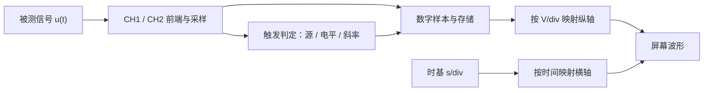
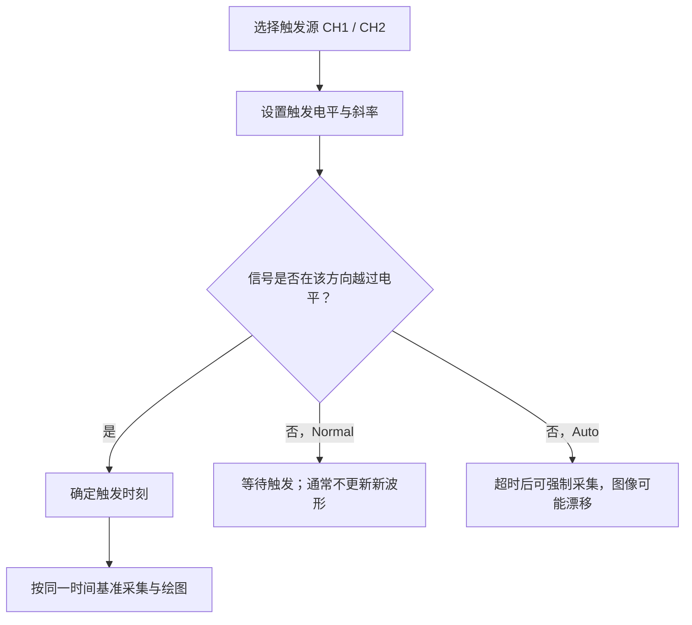
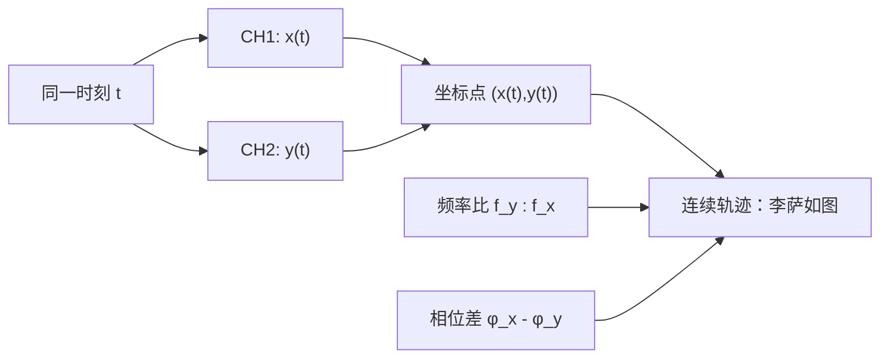

# 实验 3.1｜示波器的使用：从「为什么」到「测得出」

> [!abstract] 本实验的核心问题
> 为什么**电压随时间变化**能变成屏幕上的线？为什么波形会漂移、触发却能让它停住？为什么两个正弦波在 X-Y 模式中会画出椭圆、8 字形等轨迹？
>
> 先用 3 分钟写下预测，再打开 [交互式实验室](visuals/示波器与李萨如图-交互实验室.html) 核对。**观察到 ≠ 理解了；模拟结果 ≠ 实物测量。**

## 0. 你提供的教材与报告，究竟要求什么？

- **教材第 45–46 页**：传统电子束示波器的电场偏转与锯齿扫描，为什么时间波形能在屏幕稳定出现；X-Y 模式与李萨如图。
- **教材第 47–48 页**：模拟示波器 GOS6051、数字示波器的面板功能；注意教材的传统旋钮名称与实验室触摸屏型号不完全一致。
- **教材第 49 页**：实际仪器为 SDG2000 系列函数/任意波发生器一类设备，需生成正弦、三角、方波、脉冲等。
- **实验报告第 1 页**：连 CH1/CH2；设置 CH1 = 10 kHz 正弦，5 Vpp，Offset 0 V，Phase 0°；CH2 = 25 kHz 三角波，7 Vpp，Offset 1 V，Phase 0°；观察自动设置、触发、电压和时基。
- **实验报告第 2 页**：手工格数法测 CH1 峰峰值与周期、游标测 CH2 的 Vmax/Vmin、自动测 CH2 频率、X-Y 李萨如图、选做方波占空比。

这是**学习材料和预期值整理**，不是已完成的实验数据；报告需要按课堂要求和现场仪器记录。

## 1. 把陌生术语先放进「输入—作用—输出」框架

| 术语 | 它输入什么？ | 它做什么？ | 你在屏幕上看到什么？ |
| --- | --- | --- | --- |
| CH1 / CH2 | 电压信号 | 独立采集并显示 | 两条波形，可分别开关 |
| 垂直档位（V/div） | 电压值 | 把每伏映射为多少格 | 波形变高/矮；**信号本身不变** |
| 水平时基（s/div） | 时间 | 把时间映射到横向每格 | 周期在屏幕占几格 |
| Offset（发生器） | 一路信号 | 为信号叠加直流分量 | 波形整体上/下移动，真实电压变了 |
| Position（示波器） | 显示系统 | 改变波形在画面的位置 | 画面上/下移动，真实电压未变 |
| 触发源 | 一路参考信号 | 指定哪个通道控制采集起点 | 双通道的显示时间基准一致 |
| 触发电平 + 斜率 | 选定波形 | 在指定上升沿/下降沿穿过电平时触发 | 合适条件下波形稳定 |
| X-Y 模式 | 两个信号 | 画 (x(t),y(t))，替代时间横轴 | 李萨如曲线 |

### 1.1 最短的数学模型

单通道信号可以写作：

$$
u(t)=A\sin(2\pi ft+\varphi)+U_0
$$

- `A`：峰值（不是峰峰值）；`V_{pp}=2A`。
- `f`：频率，一秒重复多少次；`T=1/f`。
- `φ`：初相位；`U_0`：直流偏置；`V_{\max}=U_0+A,\;V_{\min}=U_0-A`。
- 方波和三角波也可有幅值、频率、偏置，但其形状**不是**这个正弦函数。

**先预测 A**：信号是 5 Vpp、0 V offset 的正弦波，峰值、最大、最小电压分别是多少？（答案见第 7 节。）

## 2. 屏幕上为什么会出现电压—时间曲线？

古典电子束示波器：Y 偏转板随输入电压改变电子束**纵向位置**；X 偏转板加入近似匀速的锯齿扫描电压，让亮点从左到右移动。扫描与波形重复协调后，视觉上形成稳定曲线。锯齿的快速回扫不能被误解为信号本身瞬间下跌。

现代数字存储示波器（DSO）通常使用采样、模数转换、存储与屏幕绘图来显示，**不是每一台数字示波器内部都靠阴极射线管和锯齿偏转**；但「横轴时间、纵轴电压」的抽象仍相同。

### 2.1 观察实验：只改一个旋钮

选择 CH1 的 10 kHz、5 Vpp 正弦波，分别做三次预测：

1. 保持发生器设置不变，把示波器 V/div 减半：理论上屏幕波形高度怎样变化？（更高；若超过屏幕则裁切。）
2. 保持信号不变，把 s/div 从 50 μs 改为 20 μs：屏幕上能装下的周期数怎样变化？（更少。）
3. 发生器 Offset 从 0 V 改为 1 V，与只改示波器 Position 的区别是什么？（前者改变实际电压；后者只改变显示位置。）

## 3. 触发：不是让波形停止，而是让「每次观察从同一事件开始」

屏幕更新时，若采集起点在波形的不同相位，画面就像左右漂移。触发器检测某一路信号**沿规定斜率越过设定电压**的瞬间，以此作为重复采集的时间参考。

- **触发源 CH1** 通常先让 CH1 稳定；选 CH2 则先让 CH2 稳定。两路若频率和相位关系不严格固定，即使共用时间轴，也**不能保证同时长期稳定**。
- 对 CH1 = 5 Vpp、0 V offset 理想正弦，电压范围是 -2.5 V 到 +2.5 V。设触发电平为 +4 V，不可能出现该电平的穿越事件，Normal 下无法获得新触发。
- **Auto Set** 很方便，但它不是物理定律，也未必为每个通道找到最优设置。自动触发和自动设置是两个不同概念。

**先预测 B**：触发选 CH1 上升沿，触发电平从 0 V 改为 +1 V（仍在范围内），稳定显示的起点会不会改变？为什么？

## 4. 用格数测电压和时间

模拟与数字示波器都能用「观察几格 × 每格刻度」作为基本检查：

$$
V_{pp}=N_y\times(\mathrm{V/div}),\qquad
T=N_x\times(\mathrm{s/div}),\qquad f=\frac1T
$$

这里 `N_y` 是波峰到波谷的**垂直**格数，`N_x` 是一个周期的**水平**格数。必须记下对应通道和探头衰减倍率是否匹配。

| 用作自检的**示例设置**（非实测） | 理论结果 |
| --- | --- |
| CH1 5 Vpp，以 1 V/div 显示 | 波峰到波谷约 5 格 |
| CH1 10 kHz，时基为 50 μs/div | 1 周期 100 μs，约 2 格 |
| CH2 7 Vpp，Offset +1 V | `Vmax=+4.5 V, Vmin=-2.5 V`（理想三角波） |
| CH2 25 kHz | `T=40 μs` |

> [!warning] Vpp 与 Vp 不是同一个量
> `Vpp`（峰峰值）是 `Vmax-Vmin`；`Vp`（峰值）对无偏置对称信号为 `Vpp/2`。报告标“峰峰值”时别把 5 Vpp 写为 2.5 V。

### 4.1 仪器校验意识

仪器自动频率、电压测量是另一套算法，不代表必然无误。探头 1×/10×、通道耦合 AC/DC、屏幕截断、采样率、噪声、输入阻抗、信号发生器负载设置（如 Hi-Z / 50 Ω）都可能改变读数或显示。仪器和信号源的负载设置不一致时，输出电压与设定值也可能不符。

## 5. X-Y 模式：同一个 t，得到屏幕上的一个 (x,y) 点

常规波形：`横坐标 = 时间 t`，`纵坐标 = 电压 u(t)`。

X-Y 模式：`x=A_x sin(2πf_x t+φ_x)`，`y=A_y sin(2πf_y t+φ_y)`。每个时刻同时取两路电压，绘出点 `(x(t),y(t))`，不断连起来形成李萨如曲线。通常 CH1→X、CH2→Y，**请以实机 X-Y 菜单为准**。

- **相同频率（1:1）**：相位差 0° → 直线；180° → 反向斜线；90° 且两轴幅值相同时 → 圆；幅值不同 → 椭圆。
- **不同有理数频率比（1:2、2:3）**：轨迹一般可闭合，叶瓣与交叉形状由频率比与相位差共同决定；不能凭“像 8 字”就忽略坐标轴和初相位直接断言频率。
- **独立信号源的频率有微小差别**：相位会缓慢漂移；XY 图可能缓慢旋转或变形。这不是图形功能失效。

### 5.1 和报告设置建立联系（CH2 固定 20 kHz）

| 目标 `f_y:f_x` | 若 CH2→Y，则 CH2 频率 | 应将 CH1→X 调为 |
| --- | --- | --- |
| 1:1 | 20 kHz | 20 kHz |
| 1:2 | 20 kHz | 40 kHz |
| 2:3 | 20 kHz | 30 kHz |

每一比值再分别试 0° 与报告指定的第二相位差（1:1 及 1:2 为 90°；2:3 为 45°）。**相位差的正负方向**取决于设备和教材采用 `φ_x−φ_y` 还是 `φ_y−φ_x`；手动报告应把定义写清。

## 6. 实验室操作：每次只改变一个因素

1. 按老师提供的**低压信号发生器—示波器实验线路**连接 CH1 / CH2，检查 BNC / 探头匹配、输入与接地。不要把示波器普通探头直接用于市电、未知高压、或未知参考地的线路。
2. 设置发生器两路波形，按输出开关实际开启输出；拍摄或记录每路频率、Vpp、Offset、Phase、输出负载设置。
3. 使用 Auto Set 观察；依次开关 CH1、CH2；手动试垂直档位与水平时基，先猜变化再看屏幕。
4. 选择触发源 CH1，调电平到波形范围外，再调回；分别观察 Auto / Normal 和不同斜率。**屏幕是否更新、是否漂移**要分开记录。
5. 用格数法测 CH1 的电压和周期，游标法测 CH2 的最大/最小电压，Measure 自动测 CH2 频率。把理论值、仪器读数和单位写在不同列。
6. 先把 CH2 改为 20 kHz 正弦，再按上表改变 CH1；切到 X-Y，记录 1:1、1:2、2:3 的两组相位图。
7. （选做）CH1 设置 1 kHz 方波，依次 Duty 70%、30%，测高电平宽度和周期，计算占空比。

> [!warning] 安全及信号约束
> 本教程只针对实验室提供的低压信号源。常见台式示波器各通道探头地夹共享接地，**不可任意夹到带电点**；不拆改电源保护接地，不尝试测量插座电压。具体连接遵守任课教师和设备说明。

## 7. 立即自测：先答，再核对

思考题 1：CH1 5 Vpp、Offset 0 V；CH2 7 Vpp、Offset +1 V。各自的电压范围？

CH1 为 [-2.5, +2.5] V；CH2 为 [-2.5, +4.5] V。CH2 的 Vpp=7 V，不是 Vmax=7 V。

思考题 2：改变示波器垂直档位能否改变信号幅度？

不能，只是改变信号在屏幕映射成多少格。改变发生器幅度才可能改变输入信号实际幅度。

思考题 3：触发范围外与两路不同步有什么不同？

触发范围外：所选参考信号不越过电平，Normal 无法采到新的触发事件。两路不同步：某一路可以触发并稳定，但另一信号对该路的相对相位仍可变化。

思考题 4：1 kHz 方波，70% 与 30% 的理论高电平宽度？

T=1 ms；70%→0.7 ms；30%→0.3 ms。此处只是**发生器理想设定的预期**，实测请看示波器。

思考题 5：为什么 1:1 的 XY 图可以是线也可以是圆？

因为频率比只告诉你重复速率；相位差才影响两轴同一时刻电压的配对。0° 同步同向为线；90° 且两轴幅度相同为圆。

## 8. 拓展资料：按问题而不是按顺序读

- **A 必读，横纵轴和触发**：[Tektronix《XYZs of Oscilloscopes》](https://www.tek.com/en/documents/primer/xyzs-oscilloscopes-primer)、[三大控制系统](https://www.tek.com.cn/documents/primer/oscilloscope-systems-and-controls)。查 vertical/horizontal/trigger，配合第 2–3 节。
- **A 必读，李萨如**：[Durham University · Lissajou Figures](https://dur.ac.uk/departments/academic/physics/labs/skills/oscilloscope/lissajou-figures/)。先猜 0°/90°，再看不同横纵频率。
- **B 按需查，Auto/Normal**：[Keysight · Trigger Settings](https://helpfiles.keysight.com/BenchVueSoftware_HDML5HelpFiles/USBModular/ScopeApp/English/Content/GUI/Instrument%20Settings/Trigger%20Settings.htm)。适合触发功能混乱时核对。
- **B 按需查，垂直与时基**：[Tektronix · Understanding Vertical and Horizontal Settings](https://www.tek.com/en/blog/understanding-vertical-and-horizontal-settings-tbs2000-part-1-xyzs-series)。
- **安全提示**：[Tektronix · ABCs of Probes](https://www.tek.com/en/documents/whitepaper/abcs-probes-primer)。理解普通接地探头的参考地限制。
- **扩展读物**：[国立阳明交通大学物理实验讲义（含 Lissajous）](https://physlab.ep.nycu.edu.tw/wp-content/uploads/2026/02/%E8%AC%9B%E7%BE%A9_%E5%AF%A6%E9%A9%97_114_II_E-cmtu-P19-260128.pdf)。

这些链接是学习参考，不等于你的具体示波器型号说明书；面板位置、菜单命名及相位设置应以实验室实物为准。

## 9. 掌握标准（不用填“已学会”）

- **解释**：不看教材，说明 V/div、s/div、trigger 与 XY 的各自作用和一个常见误解。
- **预测**：给定 10 kHz / 5 Vpp，独立计算频率、最大最小、格数变化；给定 1:2 画出大致 XY 形状。
- **测量**：现场保存两路设置、格数、游标/自动测量的原始证据。
- **反例**：触发调到信号电压范围外，预测 Auto/Normal 行为并核对；将示波器 Position 与发生器 Offset 做对照。
- **迁移**：将 CH1 的频率改为 5 kHz，保持时基，独立解释屏幕周期数变化。

[[README|返回课程入口]] · [[实验3.1-示波器的使用-报告辅助与核验|实验报告辅助]]
